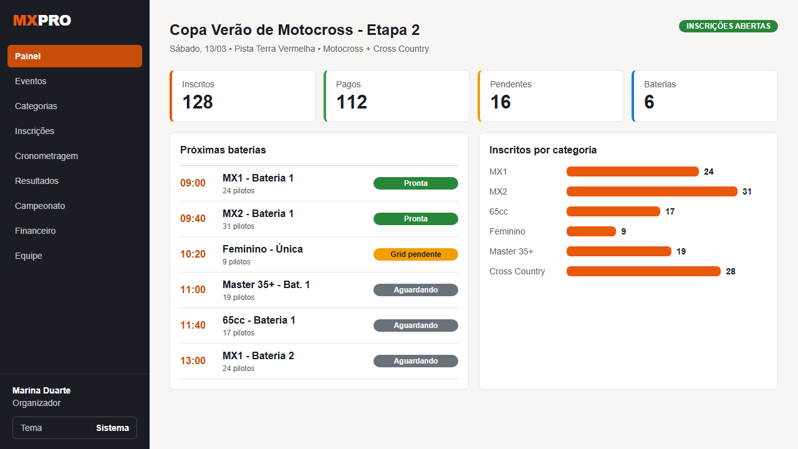
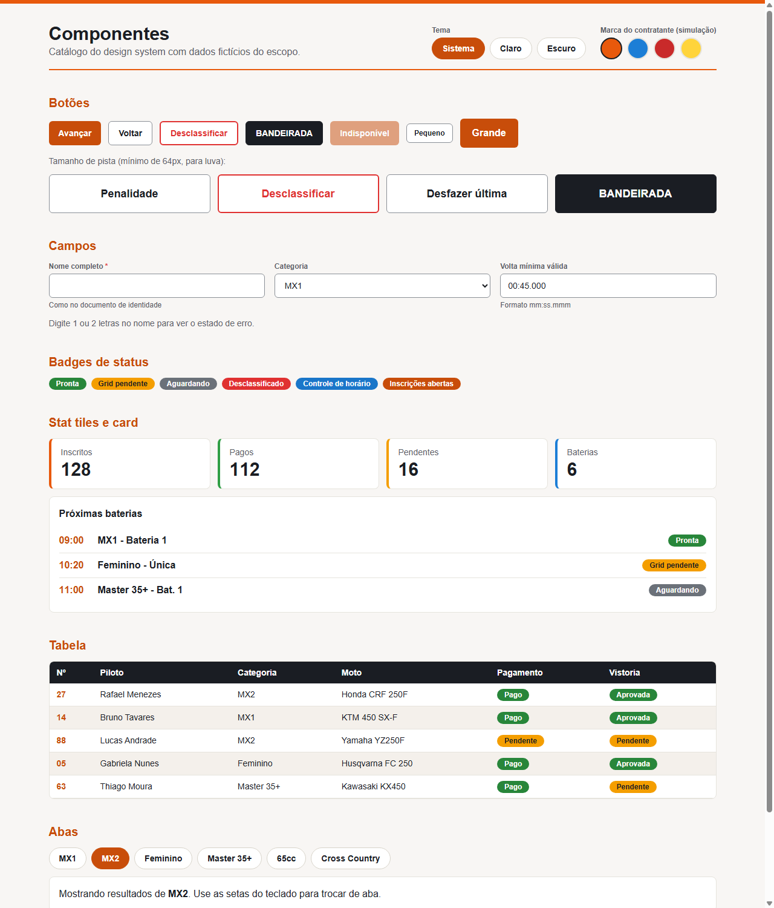

<div align="center">

# MXPro

**Plataforma de gestão de provas de motociclismo off-road**

Inscrição com Pix, cronometragem offline na pista e resultado ao vivo no celular e no telão.<br>
Motocross • Enduro • Enduro de Regularidade • Cross Country • Supercross/Arenacross

[](https://github.com/DestroyerIG/MXPro/actions/workflows/ci.yml)


</div>

---

## Sumário

- [Sobre o projeto](#sobre-o-projeto)
- [Telas](#telas)
- [Funcionalidades](#funcionalidades)
- [Princípios de arquitetura](#princípios-de-arquitetura)
- [Stack](#stack)
- [Começando](#começando)
- [Rotas disponíveis](#rotas-disponíveis)
- [Estrutura do repositório](#estrutura-do-repositório)
- [Qualidade e testes](#qualidade-e-testes)
- [Roadmap](#roadmap)
- [Convenções](#convenções)
- [Documentação](#documentação)
- [Licença](#licença)

## Sobre o projeto

O MXPro é um sistema web **exclusivo, desenvolvido sob demanda** (single-tenant, não é SaaS) para organizar provas
off-road de ponta a ponta. O organizador configura formato da prova, categorias, pontuação e forma de cronometrar
sem precisar de programador. Os pilotos se inscrevem e pagam por Pix, a equipe de pista lança passagens em tablet
ou celular, **mesmo sem internet**, e o público acompanha a classificação **ao vivo**.

**Jornada de uma prova**

```
Configurar → Inscrições → Check-in → Largada → Cronometragem → Resultado → Campeonato
```

| Perfil | O que faz no sistema |
|---|---|
| **Organizador** | Eventos, campeonatos, regras, inscrições, financeiro, equipe; fecha e oficializa resultados |
| **Secretaria** | Check-in e vistoria, conferência de pagamentos, número de largada e grid |
| **Cronometrista** | Passagens, voltas, penalidades e bandeirada na tela de pista (funciona offline) |
| **Piloto** | Inscrição, pagamento via Pix, resultados, histórico e pontuação do campeonato |
| **Público e equipes** | Classificação ao vivo no celular ou no telão, sem login |

> **Estado atual:** fundação (API, banco, login por perfil, CI) e cadastro de **eventos, categorias e baterias**
> prontos, com o painel do evento mostrando dados reais. Cronometragem e telão ainda usam dados fictícios.
> Inscrições com Pix e cronometragem offline real são as próximas fases (veja o [roadmap](#roadmap)).

## Telas

<table>
  <tr>
    <td width="50%"></td>
    <td width="50%"></td>
  </tr>
  <tr>
    <td align="center"><b>Painel do evento</b><br><sub>Totais, próximas baterias e inscritos por categoria</sub></td>
    <td align="center"><b>Cronometragem (tablet)</b><br><sub>Um toque = uma passagem • indicador offline com fila de envio</sub></td>
  </tr>
  <tr>
    <td width="50%"></td>
    <td width="50%"></td>
  </tr>
  <tr>
    <td align="center"><b>Telão ao vivo</b><br><sub>Paginação automática • espaço para patrocinadores</sub></td>
    <td align="center"><b>Design system</b><br><sub>Tokens, tema claro/escuro e componentes base</sub></td>
  </tr>
</table>

## Funcionalidades

### Disponíveis

- **Design system com identidade configurável:** todas as cores vêm de design tokens (CSS variables). Nome, logo e
  cor do contratante vêm da API e são aplicados em tempo de execução; os tons derivados são calculados para garantir
  contraste **WCAG AA**. A última marca fica guardada no aparelho, para as telas abrirem certas mesmo offline. Tem
  tema claro e escuro.
- **Painel do organizador:** menu lateral responsivo (vira gaveta no celular) e painel do evento com **dados reais**:
  seletor de evento (abre o próximo publicado), totais, próximas baterias no fuso do evento e inscritos por categoria.
  Inscritos aparecem zerados, com aviso, até existir a fase de inscrições.
- **Eventos, categorias e baterias:** campeonatos e etapas (de um ou mais dias), publicar, encerrar inscrições,
  cancelar; categorias do evento com modalidade, valor em reais e vagas; programação de baterias com uma ou mais
  categorias. Catálogo único de categorias. Secretaria consulta; só o organizador altera.
- **Regras da prova (Motocross):** tela por categoria com o modelo pronto do escopo (grid por sorteio, tempo + 2
  voltas, volta mínima 0:45.000, +10 s por infração), tabela de pontos editável e desempate. O motor de regras calcula
  resultado da bateria e geral do dia; depois da largada a configuração fica congelada e cada mudança vira uma nova
  versão com motivo.
- **Recebimento pelo Mercado Pago:** na tela Financeiro, o organizador conecta a conta do Mercado Pago do contratante
  (OAuth com PKCE): o sistema nunca vê a senha, guarda os tokens criptografados e renova o acesso sozinho antes de
  vencer. Os Pix das inscrições serão gerados nessa conta.
- **Login por perfil:** cada perfil cai na sua área; sessão em cookie httpOnly; a cronometragem abre offline.
- **Cronometragem para tablet** (dados fictícios até a fase 5):
  - um toque no cartão registra uma passagem;
  - penalidade e desclassificação "armam" o próximo toque;
  - **Desfazer** no lugar de diálogos de confirmação;
  - bandeirada;
  - indicador **OFFLINE** com contador de pendentes e sincronização em lotes ao reconectar.
- **Telão ao vivo** (dados fictícios até a fase 6):
  - classificação com posição, voltas, melhor volta e diferença para o líder (ou "+N voltas");
  - paginação automática para baterias grandes e tipografia proporcional à tela;
  - aviso de dados desatualizados quando a conexão cai.

### Planejadas

Inscrição pública com Pix e confirmação por webhook • check-in e vistoria • geração de grid • regras das demais
modalidades • resultado oficial em PDF e planilha • campeonato com descarte e desempate • área do
piloto • Enduro (especiais e controles de horário) • integração com transponder • LGPD (consentimento, exportação e
anonimização).

## Princípios de arquitetura

1. **A cronometragem nunca perde um lançamento.** Tudo o que o cronometrista toca é salvo no aparelho primeiro e
   sincronizado depois.
2. **Eventos imutáveis (append-only).** Passagens, penalidades e desclassificações são eventos. Classificação e
   resultados são **derivados** deles. Corrigir é registrar um novo evento (`UNDO`), nunca editar ou apagar.
3. **Toda correção de tempo é auditada:** quem, quando, por quê, valor antes e depois.
4. **Regras de prova são dados, não código.** O motor de regras é uma biblioteca pura e determinística: mesmos
   eventos + mesma configuração = mesmo resultado.
5. **Idempotência em tudo que sincroniza.** Cada evento tem UUID gerado no aparelho, e reenvios não duplicam nada.
6. **Tempo em milissegundos inteiros e dinheiro em centavos inteiros.** A formatação acontece só na apresentação.
7. **Identidade visual do contratante** aplicada por configuração em telas públicas, telão e PDFs.
8. **LGPD:** coleta mínima de dados e nada de dados pessoais em páginas públicas.

Detalhes em [`docs/arquitetura.md`](docs/arquitetura.md).

## Stack

| Camada | Tecnologia |
|---|---|
| Front-end | **Angular 22** (standalone components, Signals, `OnPush`, zoneless, rotas lazy por área) |
| Estilo | **Tailwind CSS 4** sobre design tokens próprios (paleta padrão do Tailwind desativada) |
| Linguagem | **TypeScript** em modo `strict` |
| Monorepo | **pnpm workspaces** |
| Testes | **Vitest** + Angular TestBed (`RouterTestingHarness`, testes de componente e de funções puras) |
| Offline (planejado) | `@angular/service-worker` + IndexedDB (Dexie) |
| Banco | **PostgreSQL 18** + **Prisma 7** (migrations versionadas, travas `CHECK` no banco), Docker Compose |
| API (em construção) | Node.js + Fastify + Zod, sessão em cookie httpOnly, WebSocket |

## Começando

### Pré-requisitos

- **Node.js 22.20** ou superior
- **pnpm 12** (`npm install -g pnpm`)

### Instalação e execução

```bash
git clone https://github.com/DestroyerIG/MXPro.git
cd MXPro
pnpm install
cp .env.example .env
pnpm db:up && pnpm db:migrate && pnpm db:seed   # banco (requer Docker)
pnpm dev            # front em http://localhost:4200 + API em http://localhost:3000
```

### Banco de dados (desenvolvimento)

Requer **Docker** em execução. O Postgres sobe na porta **5433** (para não conflitar com uma instalação local).

```bash
cp .env.example .env   # ajuste se necessário; o .env nunca é versionado
pnpm db:up             # sobe o PostgreSQL 18 (docker compose)
pnpm db:migrate        # aplica as migrations
pnpm db:seed           # dados fictícios: usuários, marca, campeonato, etapas, categorias, baterias e inscrições
pnpm db:studio         # (opcional) navegador visual do banco
```

Usuários do seed: `organizador@mxpro.test`, `secretaria@mxpro.test`, `cronometrista@mxpro.test` e
`piloto@mxpro.test`, todos com a senha `SEED_PASSWORD` do `.env`. O seed também cria a "Copa Verão de
Motocross" 2027: a Etapa 2 publicada, com 6 categorias, 6 baterias e os 8 inscritos da página 5 do escopo
(pagos e pendentes, vistoria aprovada e pendente), e a Etapa 3 em rascunho. Os pilotos fictícios entram com
`<nome.sobrenome>@mxpro.test` e a mesma senha. É idempotente e se recusa a rodar com `NODE_ENV=production`.

**Modelo de eventos:** campeonato → evento (etapa ou avulso, de um ou mais dias) → categorias do evento
(modalidade, valor em centavos e vagas, a partir de um catálogo único de categorias) → baterias, que podem
juntar mais de uma categoria. Regras críticas também são garantidas pelo próprio banco (`CHECK` e chaves
compostas): datas e janela de inscrição coerentes, valores não negativos, categoria sem duplicata e bateria
ligada só a categorias do mesmo evento.

**Modelo de inscrições** ([ADR 0004](docs/decisions/0004-inscricoes-e-pix.md)): inscrição (piloto × categoria
do evento) → cobranças Pix, mais o registro dos consentimentos (LGPD). O banco garante:
- nº de largada único por categoria entre as inscrições ativas, com "05" e "5" como números diferentes;
- uma inscrição ativa por piloto em cada categoria;
- prazo de reserva da vaga enquanto o Pix não é pago;
- uma cobrança em aberto por inscrição;
- webhook do gateway gravado uma única vez.

**Mercado Pago** ([ADR 0005](docs/decisions/0005-mercado-pago-oauth.md)): para conectar uma conta em desenvolvimento,
é preciso um aplicativo no Mercado Pago ("Suas integrações"):
1. cadastre nele a URL de retorno, igual a `MP_REDIRECT_URI`;
2. habilite o PKCE;
3. preencha as variáveis `MP_*` e `PAYMENT_TOKEN_KEY` no `.env` (veja o `.env.example`).

Sem elas, a tela Financeiro explica o que falta e o resto do sistema funciona normalmente.

### Scripts

| Comando (na raiz) | O que faz |
|---|---|
| `pnpm dev` | Front (`ng serve`) e API (`tsx watch`) juntos; `dev:web` / `dev:api` sobem só um |
| `pnpm build` | Build de produção de todos os pacotes |
| `pnpm test` | Testes unitários de todos os pacotes |
| `pnpm typecheck` | Checagem de tipos (`tsc --noEmit`) |
| `pnpm lint` / `lint:fix` | ESLint em todo o monorepo (TypeScript, Angular e acessibilidade dos templates) |
| `pnpm db:up` / `db:down` | Sobe / derruba o PostgreSQL de desenvolvimento |
| `pnpm db:migrate` | Cria/aplica migrations (Prisma) |
| `pnpm db:seed` | Popula o banco com dados fictícios |

No pacote do front (`apps/web`): `pnpm exec ng build`, `pnpm exec ng test --watch=false`,
`pnpm exec ng generate component features/<area>/<nome>`.

## Rotas disponíveis

| Rota | Tela | Quem acessa |
|---|---|---|
| `/entrar` | Login (e-mail e senha) | Equipe e pilotos |
| `/painel` | Painel do evento | Organizador / secretaria |
| `/painel/eventos` | Lista de eventos com filtro por status | Organizador / secretaria (só consulta) |
| `/painel/eventos/novo` · `/painel/eventos/:id` | Criar e editar evento; publicar, encerrar/reabrir inscrições, cancelar e excluir rascunho | Organizador (secretaria vê sem editar) |
| `/painel/eventos/:id?aba=categorias` · `?aba=baterias` | Categorias do evento (modalidade, valor em reais, vagas) e programação de baterias (uma ou mais categorias, horário no fuso do evento) | Organizador (secretaria vê sem editar) |
| `/painel/eventos/:id/categorias/:eventCategoryId/regras` | Regras da prova da categoria: modelo pronto, largada, término, duração, baterias, volta mínima, penalidade, % mínimo para classificar, tabela de pontos e desempate. Depois da largada, mudar exige motivo e cria nova versão | Organizador (secretaria vê sem editar) |
| `/painel/categorias` | Catálogo de categorias: criar, renomear, desativar e excluir as nunca usadas | Organizador (secretaria vê sem editar) |
| `/painel/financeiro` | Conta do Mercado Pago que recebe as inscrições: conectar (OAuth), ver a conta e desconectar | Organizador |
| `/painel/<área>` | Inscrições, Cronometragem, Resultados, Campeonato, Equipe | Organizador / secretaria |
| `/cronometragem` | Tela de pista para tablet/celular | Cronometrista / organizador |
| `/ao-vivo/telao` | Classificação ao vivo em modo telão | Público (sem login) |
| `/componentes` | Catálogo do design system | Desenvolvimento |

A raiz (`/`) leva cada perfil para a sua área. Quem abre uma área sem estar logado vai para `/entrar` e volta
para ela depois do login. Quem abre a área de outro perfil é levado para a sua. Esses guards de rota só melhoram
a navegação: a permissão de verdade é checada pela API em toda rota. Depois do primeiro login confirmado no
aparelho, a cronometragem abre mesmo sem internet.

**API** (`http://localhost:3000`)

| Endpoint | Descrição |
|---|---|
| `GET /api/health` | `200` com API e banco no ar; `503 "degradado"` se o banco cair |
| `POST /api/auth/login` | Login (e-mail e senha); cria sessão em cookie httpOnly. Limite: 10 tentativas/15 min por IP |
| `POST /api/auth/logout` | Encerra a sessão (vale na hora) |
| `GET /api/auth/me` | Usuário logado e validade da sessão |
| `GET /api/users` | Equipe da organização — **somente organizador** |
| `GET /api/settings/branding` | Marca do contratante (nome, destaque, cor, logo) — público |
| `PUT /api/settings/branding` | Altera a marca — **somente organizador** |
| `GET /api/championships` | Campeonatos com o número de etapas — organizador e secretaria |
| `POST /api/championships` · `PATCH`/`DELETE /api/championships/:id` | Cria, renomeia e exclui (só sem etapas) — **somente organizador** |
| `GET /api/events` · `GET /api/events/:id` | Eventos (filtros `status` e `championshipId`), com a janela de inscrição e se está aberta agora — organizador e secretaria |
| `GET /api/events/:id/dashboard` | Painel do evento numa resposta só: evento, modalidades, próximas baterias e inscritos por categoria — organizador e secretaria |
| `POST /api/events` · `PATCH /api/events/:id` | Cria (como rascunho) e edita; as regras entre campos valem no resultado da edição — **somente organizador** |
| `POST /api/events/:id/publish` · `/cancel` | Publica (exige ao menos uma categoria) e cancela — **somente organizador** |
| `DELETE /api/events/:id` | Exclui só rascunho vazio; os demais são cancelados — **somente organizador** |
| `GET /api/categories` · `POST` · `PATCH`/`DELETE /api/categories/:id` | Catálogo de categorias (filtro `active`); categoria já usada é desativada, não excluída — leitura: organizador e secretaria; alteração: **somente organizador** |
| `GET`/`POST /api/events/:id/categories` · `PATCH`/`DELETE …/:eventCategoryId` | Categorias do evento: modalidade, valor em centavos e vagas. Não sai do evento se estiver em bateria ou for a última de um evento publicado |
| `GET`/`PUT /api/events/:id/categories/:eventCategoryId/rules` | Regras da prova da categoria (configuração versionada do motor). Sem nada salvo, devolve o modelo pronto. Depois da largada fica congelada: mudar exige motivo e cria nova versão — alteração: **somente organizador** |
| `GET`/`POST /api/events/:id/heats` · `PATCH`/`DELETE …/:heatId` | Baterias com uma ou mais categorias e horário dentro das datas do evento (no fuso dele). Só bateria programada é alterada |
| `GET`/`DELETE /api/payments/mercadopago` | Conta do Mercado Pago conectada (sem tokens) / desconectar — **somente organizador** |
| `POST /api/payments/mercadopago/connect` | Inicia a conexão OAuth: devolve a URL de autorização do Mercado Pago — **somente organizador** |
| `GET /api/payments/mercadopago/callback` | Retorno do Mercado Pago (navegação do navegador): confere o `state`, troca o código pelos tokens e volta para `/painel/financeiro?mercadopago=<resultado>` |

Autenticação por sessão em cookie `httpOnly` com senha **argon2id**, autorização por perfil no back-end e proteção
contra CSRF. Detalhes e motivos em [`docs/decisions/0002`](docs/decisions/0002-autenticacao-por-sessao-em-cookie.md).

Em desenvolvimento o `ng serve` encaminha `/api` para a API (`apps/web/proxy.conf.json`): front e API ficam na
mesma origem, como em produção. Os pacotes do workspace (`@mxpro/shared`, `@mxpro/rules-engine`) ficam fora do
pré-empacotamento do Vite (`prebundle.exclude` no `angular.json`): mudanças neles entram no `ng serve` sem
reiniciar.

Todo erro da API segue o formato `{ code, message, details? }`, com mensagens em português.

> Na tela de cronometragem, em modo de desenvolvimento, a opção **"Simular queda de internet"** permite testar o
> fluxo offline sem desligar a rede.

## Estrutura do repositório

```
MXPro/
├─ apps/
│  ├─ api/                      # Fastify: configuração validada, erros padronizados, health check
│  └─ web/                      # Angular: painel, cronometragem, ao vivo
│     └─ src/
│        ├─ styles/tokens.css   # design tokens (claro, escuro e telão)
│        └─ app/
│           ├─ core/            # serviços singleton: marca, tema, sessão, conectividade
│           ├─ shared/          # componentes de UI, formatação de tempo/data, logo
│           └─ features/        # uma pasta por área, cada uma com rotas lazy
│              ├─ organizer/    #   painel do organizador
│              ├─ timekeeping/  #   cronometragem (log de eventos + derivações puras)
│              ├─ live/         #   resultado ao vivo / telão
│              └─ design-system/#   catálogo de componentes
├─ packages/
│  ├─ db/                       # Prisma: schema, migrations, seed e cliente do banco
│  ├─ rules-engine/             # motor de regras: funções puras e determinísticas (sem banco/rede/relógio)
│  └─ shared/                   # schemas Zod e tipos usados pela API e pelo front
│                               # (próxima: timing-adapters, para leitores de transponder)
└─ docs/
   ├─ arquitetura.md            # escopo, princípios, arquitetura, convenções e roadmap
   ├─ design/                   # direção visual e prévia interativa
   └─ imagens/                  # capturas de tela
```

## Qualidade e testes

- **193 testes automatizados**: 142 no front, 38 de integração na API (com PostgreSQL de verdade) e 13 nos
  contratos compartilhados. Cobrem:
  - formatação de tempo (truncamento de milésimos, contagem regressiva, diferença para o líder);
  - fuso horário do evento;
  - derivações do log de cronometragem (voltas, desfazer, penalidade, DSQ, eventos fora de ordem);
  - contraste da cor de marca;
  - sessão, login, guards de rota por perfil e sessão expirada (inclusive abertura offline);
  - rotas, estados de carregamento e erro, e interações das telas;
  - API: login, sessão, perfis de acesso, CSRF, limite de tentativas e marca do contratante.
- **CI no GitHub Actions** a cada push e pull request: tipos, ESLint, migrations do zero + seed, testes
  (com um Postgres no pipeline) e build de produção. As actions são fixadas pelo SHA do commit.
- **ESLint** com `typescript-eslint` e `angular-eslint`, incluindo as regras de acessibilidade dos templates e
  a proibição de promessas esquecidas sem `await`.
- **Acessibilidade:** contraste AA medido em todos os pares de cor, foco sempre visível, navegação por teclado
  (abas com setas, "Pular para o conteúdo", Esc fecha menus), `aria-current`, `aria-live` para estados de conexão
  e textos para leitores de tela.
- **Definição de pronto:** tipos, lint e testes passando, build de produção sem avisos, componentes standalone + `OnPush`
  e rotas novas carregadas sob demanda.

```bash
pnpm typecheck
pnpm lint
pnpm test        # a API precisa do Postgres: pnpm db:up
pnpm build
```

## Roadmap

- [x] **Front-end, primeira fatia:** app Angular, design system, painel do organizador, painel do evento,
      cronometragem para tablet e telão ao vivo (dados fictícios)
- [x] **Fundação:** ~~PostgreSQL + Prisma, seeds~~ ✓ • ~~API Fastify~~ ✓ • ~~autenticação e perfis de acesso (RBAC)~~ ✓ • ~~marca via API~~ ✓ • ~~login no front~~ ✓ • ~~CI~~ ✓
- [x] **Eventos e categorias:** cadastro de campeonato, evento, categoria e bateria, e painel do evento com dados reais
- [x] **Motor de regras (Motocross):** ~~configuração versionada e modelo pronto~~ ✓ • ~~resultado da bateria (tempo + voltas,
      volta mínima, penalidades, DSQ)~~ ✓ • ~~pontos e desempate~~ ✓ • ~~configuração por categoria (API), congelada na largada~~ ✓ • ~~tela de regras~~ ✓.
      Regras decididas no [ADR 0003](docs/decisions/0003-regras-do-motocross.md)
- [ ] **Inscrição + Pix (Mercado Pago):** ~~modelo de dados~~ ✓ • ~~conexão da conta (OAuth)~~ ✓ • cobrança Pix e
      webhook • API de inscrição • formulário público e pagamento • lista de inscritos, check-in e vistoria • grid.
      Regras decididas nos ADRs [0004](docs/decisions/0004-inscricoes-e-pix.md) e [0005](docs/decisions/0005-mercado-pago-oauth.md)
- [ ] **Cronometragem offline real:** fila no IndexedDB, service worker, sincronização idempotente, auditoria
- [ ] **Resultados ao vivo:** WebSocket, página pública para celular, resultado oficial em PDF e planilha
- [ ] **Campeonato e área do piloto:** pontuação por etapa, descarte, perfil e histórico
- [ ] **Demais modalidades:** Enduro, Cross Country, Supercross, Regularidade e modalidade personalizada
- [ ] **Transponder, financeiro e acabamento:** integração com equipamento, LGPD, backups e testes E2E

## Convenções

- **Idioma:** interface, documentação e commits em **português do Brasil**. Nomes no código (variáveis, funções,
  tabelas) em **inglês**.
- **Commits:** padrão [Conventional Commits](https://www.conventionalcommits.org/pt-br/), por exemplo
  `feat(cronometragem): registra passagem offline na fila`.
- **Angular:** componentes standalone, `ChangeDetectionStrategy.OnPush`, Signals para estado, `inject()`, control
  flow moderno (`@if`/`@for`) e nada de lógica de negócio em componentes (vai para services e funções puras).
- **Cores:** somente por tokens. Escrever um hex dentro de um componente é considerado bug.

## Documentação

- [`docs/arquitetura.md`](docs/arquitetura.md): escopo, princípios, modelo de dados, offline e sincronização,
  tempo real, pagamentos, segurança/LGPD, convenções e roadmap.
- [`docs/design/direcao-visual.md`](docs/design/direcao-visual.md): paleta, tipografia, espaçamentos, estados e
  componentes, com os contrastes medidos.
- [`docs/design/previa-visual.html`](docs/design/previa-visual.html): prévia interativa da direção visual.

## Licença

Software proprietário, desenvolvido sob demanda. Todos os direitos reservados.
