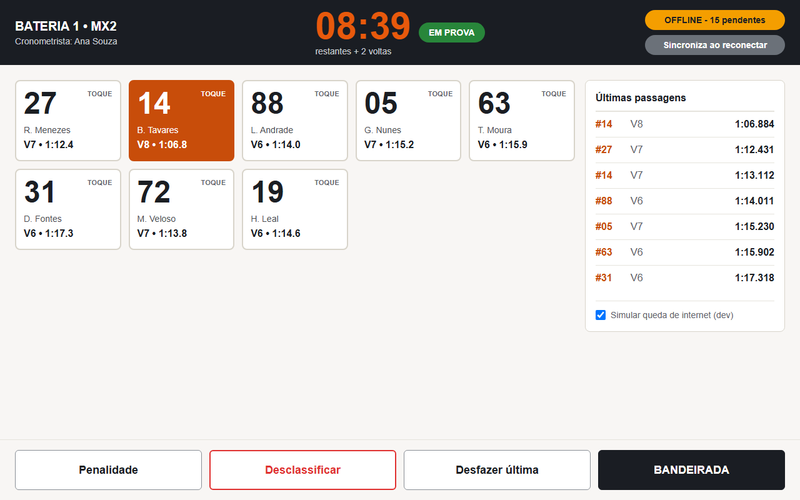
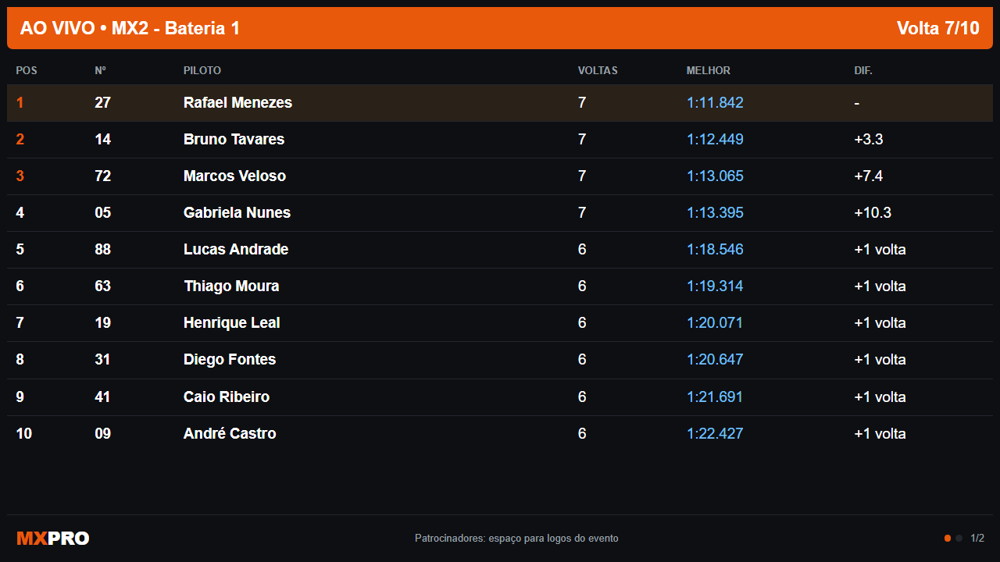

<div align="center">

# MXPro

**Plataforma de gestão de provas de motociclismo off-road**

Inscrição com Pix, cronometragem offline na pista e resultado ao vivo no celular e no telão.<br>
Motocross • Enduro • Enduro de Regularidade • Cross Country • Supercross/Arenacross


</div>

---

## Sumário

- [Sobre o projeto](#sobre-o-projeto)
- [Telas](#telas)
- [Funcionalidades](#funcionalidades)
- [Princípios de arquitetura](#princípios-de-arquitetura)
- [Stack](#stack)
- [Começando](#começando)
- [Rotas disponíveis](#rotas-disponíveis)
- [Estrutura do repositório](#estrutura-do-repositório)
- [Qualidade e testes](#qualidade-e-testes)
- [Roadmap](#roadmap)
- [Convenções](#convenções)
- [Documentação](#documentação)
- [Licença](#licença)

## Sobre o projeto

O MXPro é um sistema web **exclusivo, desenvolvido sob demanda** (single-tenant, não é SaaS) para organizar provas
off-road de ponta a ponta. O organizador configura formato da prova, categorias, pontuação e forma de cronometrar
sem precisar de programador. Os pilotos se inscrevem e pagam por Pix, a equipe de pista lança passagens em tablet
ou celular, **mesmo sem internet**, e o público acompanha a classificação **ao vivo**.

**Jornada de uma prova**

```
Configurar → Inscrições → Check-in → Largada → Cronometragem → Resultado → Campeonato
```

| Perfil | O que faz no sistema |
|---|---|
| **Organizador** | Eventos, campeonatos, regras, inscrições, financeiro, equipe; fecha e oficializa resultados |
| **Secretaria** | Check-in e vistoria, conferência de pagamentos, número de largada e grid |
| **Cronometrista** | Passagens, voltas, penalidades e bandeirada na tela de pista (funciona offline) |
| **Piloto** | Inscrição, pagamento via Pix, resultados, histórico e pontuação do campeonato |
| **Público e equipes** | Classificação ao vivo no celular ou no telão, sem login |

> **Estado atual:** a primeira fatia do front-end está pronta e roda com **dados fictícios**: design system, painel
> do organizador, cronometragem para tablet e telão ao vivo. API, banco de dados, Pix e motor de regras são as
> próximas fases (veja o [roadmap](#roadmap)).

## Telas

<table>
  <tr>
    <td width="50%"></td>
    <td width="50%"></td>
  </tr>
  <tr>
    <td align="center"><b>Painel do evento</b><br><sub>Totais, próximas baterias e inscritos por categoria</sub></td>
    <td align="center"><b>Cronometragem (tablet)</b><br><sub>Um toque = uma passagem • indicador offline com fila de envio</sub></td>
  </tr>
  <tr>
    <td width="50%"></td>
    <td width="50%"></td>
  </tr>
  <tr>
    <td align="center"><b>Telão ao vivo</b><br><sub>Paginação automática • espaço para patrocinadores</sub></td>
    <td align="center"><b>Design system</b><br><sub>Tokens, tema claro/escuro e componentes base</sub></td>
  </tr>
</table>

## Funcionalidades

### Disponíveis (front-end com dados fictícios)

- **Design system com identidade configurável:** todas as cores vêm de design tokens (CSS variables). A cor da marca
  do contratante é aplicada em tempo de execução, e os tons derivados são calculados para garantir contraste
  **WCAG AA**. Tem tema claro e escuro.
- **Painel do organizador:** menu lateral responsivo (vira gaveta no celular) e painel do evento com totais, próximas
  baterias com situação e gráfico de inscritos por categoria. Mostra estados de carregamento e de erro.
- **Cronometragem para tablet:**
  - um toque no cartão registra uma passagem;
  - penalidade e desclassificação "armam" o próximo toque;
  - **Desfazer** no lugar de diálogos de confirmação;
  - bandeirada;
  - indicador **OFFLINE** com contador de pendentes e sincronização em lotes ao reconectar.
- **Telão ao vivo:**
  - classificação com posição, voltas, melhor volta e diferença para o líder (ou "+N voltas");
  - paginação automática para baterias grandes e tipografia proporcional à tela;
  - aviso de dados desatualizados quando a conexão cai.

### Planejadas

Inscrição pública com Pix e confirmação por webhook • check-in e vistoria • geração de grid • motor de regras
configurável por modalidade • resultado oficial em PDF e planilha • campeonato com descarte e desempate • área do
piloto • Enduro (especiais e controles de horário) • integração com transponder • LGPD (consentimento, exportação e
anonimização).

## Princípios de arquitetura

1. **A cronometragem nunca perde um lançamento.** Tudo o que o cronometrista toca é salvo no aparelho primeiro e
   sincronizado depois.
2. **Eventos imutáveis (append-only).** Passagens, penalidades e desclassificações são eventos. Classificação e
   resultados são **derivados** deles. Corrigir é registrar um novo evento (`UNDO`), nunca editar ou apagar.
3. **Toda correção de tempo é auditada:** quem, quando, por quê, valor antes e depois.
4. **Regras de prova são dados, não código.** O motor de regras é uma biblioteca pura e determinística: mesmos
   eventos + mesma configuração = mesmo resultado.
5. **Idempotência em tudo que sincroniza.** Cada evento tem UUID gerado no aparelho, e reenvios não duplicam nada.
6. **Tempo em milissegundos inteiros e dinheiro em centavos inteiros.** A formatação acontece só na apresentação.
7. **Identidade visual do contratante** aplicada por configuração em telas públicas, telão e PDFs.
8. **LGPD:** coleta mínima de dados e nada de dados pessoais em páginas públicas.

Detalhes em [`docs/arquitetura.md`](docs/arquitetura.md).

## Stack

| Camada | Tecnologia |
|---|---|
| Front-end | **Angular 22** (standalone components, Signals, `OnPush`, zoneless, rotas lazy por área) |
| Estilo | **Tailwind CSS 4** sobre design tokens próprios (paleta padrão do Tailwind desativada) |
| Linguagem | **TypeScript** em modo `strict` |
| Monorepo | **pnpm workspaces** |
| Testes | **Vitest** + Angular TestBed (`RouterTestingHarness`, testes de componente e de funções puras) |
| Offline (planejado) | `@angular/service-worker` + IndexedDB (Dexie) |
| Banco | **PostgreSQL 18** + **Prisma 7** (migrations versionadas, travas `CHECK` no banco), Docker Compose |
| API (em construção) | Node.js + Fastify + Zod, sessão em cookie httpOnly, WebSocket |

## Começando

### Pré-requisitos

- **Node.js 22.20** ou superior
- **pnpm 12** (`npm install -g pnpm`)

### Instalação e execução

```bash
git clone https://github.com/DestroyerIG/MXPro.git
cd MXPro
pnpm install
pnpm dev            # abre o front em http://localhost:4200
```

### Banco de dados (desenvolvimento)

Requer **Docker** em execução. O Postgres sobe na porta **5433** (para não conflitar com uma instalação local).

```bash
cp .env.example .env   # ajuste se necessário; o .env nunca é versionado
pnpm db:up             # sobe o PostgreSQL 18 (docker compose)
pnpm db:migrate        # aplica as migrations
pnpm db:seed           # dados fictícios: 1 usuário por perfil (senha = SEED_PASSWORD do .env)
pnpm db:studio         # (opcional) navegador visual do banco
```

Usuários do seed: `organizador@mxpro.test`, `secretaria@mxpro.test`, `cronometrista@mxpro.test` e
`piloto@mxpro.test`. O seed é idempotente e se recusa a rodar com `NODE_ENV=production`.

### Scripts

| Comando (na raiz) | O que faz |
|---|---|
| `pnpm dev` | Servidor de desenvolvimento do front (`ng serve`) |
| `pnpm build` | Build de produção de todos os pacotes |
| `pnpm test` | Testes unitários de todos os pacotes |
| `pnpm typecheck` | Checagem de tipos (`tsc --noEmit`) |
| `pnpm db:up` / `db:down` | Sobe / derruba o PostgreSQL de desenvolvimento |
| `pnpm db:migrate` | Cria/aplica migrations (Prisma) |
| `pnpm db:seed` | Popula o banco com dados fictícios |

No pacote do front (`apps/web`): `pnpm exec ng build`, `pnpm exec ng test --watch=false`,
`pnpm exec ng generate component features/<area>/<nome>`.

## Rotas disponíveis

| Rota | Tela | Público-alvo |
|---|---|---|
| `/painel` | Painel do evento | Organizador / secretaria |
| `/painel/<área>` | Eventos, Categorias, Inscrições, Cronometragem, Resultados, Campeonato, Financeiro, Equipe | Organizador |
| `/cronometragem` | Tela de pista para tablet/celular | Cronometrista |
| `/ao-vivo/telao` | Classificação ao vivo em modo telão | Público |
| `/componentes` | Catálogo do design system | Desenvolvimento |

> Na tela de cronometragem, em modo de desenvolvimento, a opção **"Simular queda de internet"** permite testar o
> fluxo offline sem desligar a rede.

## Estrutura do repositório

```
MXPro/
├─ apps/
│  └─ web/                      # Angular: painel, cronometragem, ao vivo
│     └─ src/
│        ├─ styles/tokens.css   # design tokens (claro, escuro e telão)
│        └─ app/
│           ├─ core/            # serviços singleton: marca, tema, sessão, conectividade
│           ├─ shared/          # componentes de UI, formatação de tempo/data, logo
│           └─ features/        # uma pasta por área, cada uma com rotas lazy
│              ├─ organizer/    #   painel do organizador
│              ├─ timekeeping/  #   cronometragem (log de eventos + derivações puras)
│              ├─ live/         #   resultado ao vivo / telão
│              └─ design-system/#   catálogo de componentes
├─ packages/
│  └─ db/                       # Prisma: schema, migrations, seed e cliente do banco
│                               # (próximas fases: rules-engine, shared, timing-adapters)
└─ docs/
   ├─ arquitetura.md            # escopo, princípios, arquitetura, convenções e roadmap
   ├─ design/                   # direção visual e prévia interativa
   └─ imagens/                  # capturas de tela
```

## Qualidade e testes

- **93 testes unitários** cobrindo:
  - formatação de tempo (truncamento de milésimos, contagem regressiva, diferença para o líder);
  - fuso horário do evento;
  - derivações do log de cronometragem (voltas, desfazer, penalidade, DSQ, eventos fora de ordem);
  - contraste da cor de marca;
  - rotas, estados de carregamento e erro, e interações das telas.
- **Acessibilidade:** contraste AA medido em todos os pares de cor, foco sempre visível, navegação por teclado
  (abas com setas, "Pular para o conteúdo", Esc fecha menus), `aria-current`, `aria-live` para estados de conexão
  e textos para leitores de tela.
- **Definição de pronto:** tipos e testes passando, build de produção sem avisos, componentes standalone + `OnPush`
  e rotas novas carregadas sob demanda.

```bash
cd apps/web
pnpm exec ng test --watch=false
pnpm typecheck
pnpm exec ng build
```

## Roadmap

- [x] **Front-end, primeira fatia:** app Angular, design system, painel do organizador, painel do evento,
      cronometragem para tablet e telão ao vivo (dados fictícios)
- [ ] **Fundação:** ~~PostgreSQL + Prisma, seeds~~ ✓ • API Fastify • autenticação e perfis de acesso (RBAC) • marca via API • CI
- [ ] **Eventos e categorias:** cadastro de campeonato, evento, categoria e bateria
- [ ] **Motor de regras (Motocross):** baterias, grid, tempo + voltas, volta mínima, penalidades, pontos e desempate
- [ ] **Inscrição + Pix:** formulário público, pagamento, webhook, check-in, vistoria, número de largada e grid
- [ ] **Cronometragem offline real:** fila no IndexedDB, service worker, sincronização idempotente, auditoria
- [ ] **Resultados ao vivo:** WebSocket, página pública para celular, resultado oficial em PDF e planilha
- [ ] **Campeonato e área do piloto:** pontuação por etapa, descarte, perfil e histórico
- [ ] **Demais modalidades:** Enduro, Cross Country, Supercross, Regularidade e modalidade personalizada
- [ ] **Transponder, financeiro e acabamento:** integração com equipamento, LGPD, backups e testes E2E

## Convenções

- **Idioma:** interface, documentação e commits em **português do Brasil**. Nomes no código (variáveis, funções,
  tabelas) em **inglês**.
- **Commits:** padrão [Conventional Commits](https://www.conventionalcommits.org/pt-br/), por exemplo
  `feat(cronometragem): registra passagem offline na fila`.
- **Angular:** componentes standalone, `ChangeDetectionStrategy.OnPush`, Signals para estado, `inject()`, control
  flow moderno (`@if`/`@for`) e nada de lógica de negócio em componentes (vai para services e funções puras).
- **Cores:** somente por tokens. Escrever um hex dentro de um componente é considerado bug.

## Documentação

- [`docs/arquitetura.md`](docs/arquitetura.md): escopo, princípios, modelo de dados, offline e sincronização,
  tempo real, pagamentos, segurança/LGPD, convenções e roadmap.
- [`docs/design/direcao-visual.md`](docs/design/direcao-visual.md): paleta, tipografia, espaçamentos, estados e
  componentes, com os contrastes medidos.
- [`docs/design/previa-visual.html`](docs/design/previa-visual.html): prévia interativa da direção visual.

## Licença

Software proprietário, desenvolvido sob demanda. Todos os direitos reservados.
